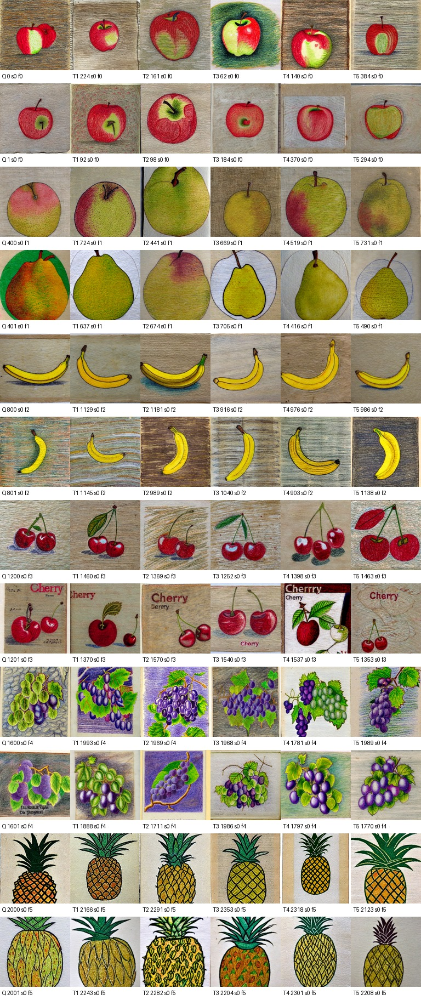

# Task3 Mac: 과일 그림 이미지 검색

과일 그림에서 비슷한 이미지를 찾는 로컬 이미지 검색 프로젝트입니다. 사전 학습된 모델로 이미지 임베딩을 추출하고, 코사인 유사도가 높은 이미지 5장을 찾아 Task3 제출 형식으로 저장합니다. OpenCLIP을 주 모델로 사용하고 ResNet18을 비교 기준으로 사용합니다.

## 진행 상태와 결과

train 이미지 7,200장으로 두 모델의 검색을 실행했습니다. 아래 수치는 **train 데이터 안에서 검색한 결과**이며, 각 질의 이미지는 자신의 검색 결과에서 제외했습니다. 별도의 test 데이터로 평가한 점수는 아닙니다.

| 모델 | Top-5 과일 일치율 | Top-5 스타일 일치율 | Top-5 과일·스타일 동시 일치율 |
| --- | ---: | ---: | ---: |
| ResNet18 | 96.61% | 95.39% | 92.11% |
| OpenCLIP ViT-B/32 | 99.05% | 99.06% | 98.12% |

각 수치는 질의 이미지마다 상위 5개 검색 결과 중 라벨이 일치하는 비율을 구한 뒤, 질의 7,200장에 대해 평균한 값입니다. 아래 이미지는 과일 6종에서 질의 이미지를 2장씩 골라 OpenCLIP 검색 결과를 보여줍니다.



현재 `data/test/images/`가 비어 있어 최종 제출용 `release/202301774.test.task3.txt`는 아직 생성하지 않았습니다.

## 데이터 구조

이미지와 라벨 CSV는 Git에 포함하지 않습니다. 로컬 프로젝트의 `data/` 아래에 다음과 같이 배치합니다.

```text
data/
  train/
    images/
    train_labels.csv
  test/
    images/
    test_labels.csv
```

라벨 CSV에는 이미지 파일명 열(`file_name`, `filename`, `image`, `path`, `id` 중 하나)과 스타일·과일 라벨 열이 필요합니다. 라벨 열 이름은 `style`, `fruit`, `style_label`, `fruit_label`을 인식합니다. 최종 설정에서는 test 이미지를 질의와 검색 대상에 모두 사용하므로, 결과에 라벨을 기록하려면 test 이미지와 해당 라벨 CSV가 필요합니다.

## macOS 실행 환경

기존 Task2 가상환경을 재사용하는 경우, 프로젝트 폴더에서 다음 명령을 실행합니다.

```bash
source /Volumes/공부/project2/task2_mac/.venv/bin/activate
python -m pip install -e .
python scripts/check_device.py
```

별도 가상환경을 사용하려면 `python -m venv .venv`로 만든 뒤 활성화하고 `python -m pip install -e .`를 실행합니다. Apple Silicon에서 PyTorch가 GPU를 사용할 수 있다면 장치 확인 결과에 `mps available: True`가 표시됩니다.

## 검색 실행

train 데이터로 파이프라인과 검색 결과를 확인합니다.

```bash
python scripts/run_retrieval.py --config configs/task3_train_debug.yaml
python scripts/run_retrieval.py --config configs/task3_openclip_train_debug.yaml
```

test 이미지와 라벨을 준비한 뒤 최종 결과를 생성합니다.

```bash
python scripts/run_retrieval.py --config configs/task3_mac.yaml
```

실행하면 `release/202301774.test.task3.txt`, 검색 평가 CSV, 결과 이미지가 생성됩니다. 결과 파일은 숫자 파일명 순서대로 질의 이미지당 한 줄이며, 각 줄에 검색된 이미지 5개의 `(id,style_label,fruit_label)` 튜플이 들어갑니다. 질의 이미지 자신은 검색 결과에서 제외합니다.

`data/`, `release/`, `work/`, 모델 가중치, 가상환경은 Git 추적 대상에서 제외합니다. GitHub에는 대표 이미지 1장만 `examples/`에 포함합니다.
