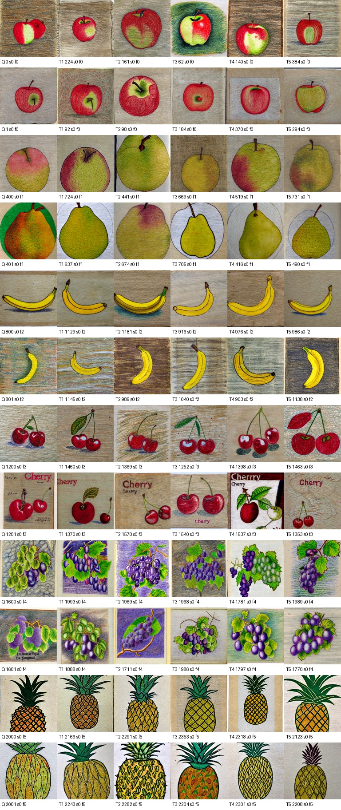

# Task3 Mac: Fruit Artwork Image Retrieval

Local image retrieval for fruit artwork. The pipeline extracts pretrained image embeddings, searches for the five most similar images by cosine similarity, and writes the Task3 tuple format. It supports OpenCLIP (main model) and ResNet18 (baseline).

## Current status

The 7,200 train images have been run through both models. The test image directory is currently empty, so the final `test.task3.txt` has not been generated. Results below measure retrieval within the train split with the query itself excluded; they are not held-out test scores.

| Encoder | Top-5 fruit match | Top-5 style match | Top-5 fruit + style match |
| --- | ---: | ---: | ---: |
| ResNet18 | 96.61% | 95.39% | 92.11% |
| OpenCLIP ViT-B/32 | 99.05% | 99.06% | 98.12% |

Each figure is the mean fraction of the five retrieved items matching the query label across all 7,200 train queries. See the [fruit-balanced OpenCLIP contact sheet](examples/openclip_train_fruit_balanced_contact_sheet.jpg) for two queries from each of the six fruit classes.



## Data layout

Dataset files are local and excluded from Git. Put images and label CSVs under `data/`:

```text
data/
  train/
    images/
    train_labels.csv
  test/
    images/
    test_labels.csv
```

The label CSV needs a filename column (`file_name`, `filename`, `image`, `path`, or `id`) and style/fruit label columns. `style`, `fruit`, `style_label`, and `fruit_label` are recognized. The final config uses the test split for both queries and gallery, so test images and their labels are needed to produce meaningful labeled tuples.

## Setup on macOS

From this project directory, activate the existing Task2 environment if available:

```bash
source /Volumes/공부/project2/task2_mac/.venv/bin/activate
python -m pip install -e .
python scripts/check_device.py
```

For an independent environment, create one with `python -m venv .venv`, activate it, then run `python -m pip install -e .`. On Apple Silicon, `scripts/check_device.py` should report `mps available: True` when PyTorch can use the GPU.

## Run

Train-only checks:

```bash
python scripts/run_retrieval.py --config configs/task3_train_debug.yaml
python scripts/run_retrieval.py --config configs/task3_openclip_train_debug.yaml
```

Once the test images and labels are present, generate the final result:

```bash
python scripts/run_retrieval.py --config configs/task3_mac.yaml
```

This writes `release/202301774.test.task3.txt`, a retrieval report, and a contact sheet. Each line contains five `(id,style_label,fruit_label)` tuples, in numeric query filename order. The query image is excluded from its own search results.

`release/`, `data/`, `work/`, model weights, and environments are ignored by Git. Only the small representative image in `examples/` is published.
